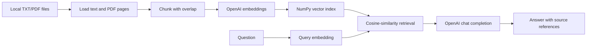

# Document RAG Assistant

A small Python retrieval-augmented generation prototype. It reads local TXT and PDF files, splits them into overlapping chunks, creates embeddings with the OpenAI API, persists a NumPy vector index, retrieves relevant chunks, and asks an OpenAI chat model to answer with source references.

## Implemented interfaces

- Streamlit chat UI
- Command-line chat and single-query mode
- FastAPI `POST /query` endpoint
- Reusable modules under `src/`

## Data flow



Retrieved documents are treated as untrusted reference data; instructions embedded in a document are not trusted as system instructions.

## Requirements

- Python 3.10 or newer
- An OpenAI API key for ingestion and answering
- Local TXT/PDF files in `data/raw/`

The sample documents are included. Ingestion sends document text to the configured embedding provider; review the data and provider terms before indexing private or sensitive documents.

## Install and configure

Windows PowerShell:

```powershell
python -m venv .venv
.venv\Scripts\Activate.ps1
python -m pip install -r requirements.txt
Copy-Item .env.example .env
```

Linux/macOS:

```bash
python3 -m venv .venv
source .venv/bin/activate
python -m pip install -r requirements.txt
cp .env.example .env
```

Set `OPENAI_API_KEY` in `.env`. The other variables are optional and validated: `CHUNK_SIZE_CHARS` must be positive, overlap must be smaller than the chunk size, `RAG_TOP_K` must be positive, and `INDEX_NAME` must be a simple name.

## Ingest and run

From the repository root, create the local index (this calls the embeddings API):

```bash
python -m src.ingest
```

Then choose one interface:

```bash
# CLI chat
python -m src.chat_cli

# Streamlit UI
python -m streamlit run streamlit_app.py

# FastAPI service
python -m uvicorn src.api:app --host 127.0.0.1 --port 8000
```

The API loads the index when the application starts. If it is missing, run ingestion first. A single API query can also be run through the helper, which ingests before answering:

```bash
python ingest_and_run.py query "What is retrieval-augmented generation?"
```

## API

`POST /query` accepts a non-empty question up to 2,000 characters and an optional `top_k` between 1 and 20.

```bash
curl -X POST http://127.0.0.1:8000/query \
  -H "Content-Type: application/json" \
  -d '{"question":"What is retrieval-augmented generation?","top_k":3}'
```

The response contains an `answer` and `sources` array with chunk IDs, cosine scores, file names, and PDF page numbers when available.

## Tests

The local unit suite covers chunk-window validation, index path validation, vector-store round trips, cosine ranking, and invalid query vectors. It does not call OpenAI or require an API key.

```bash
python -m pip install -r requirements-test.txt
python -m pytest -q
```

GitHub Actions runs the tests and compiles the source modules on pushes and pull requests.

## Security and limitations

- Keep `.env` private; it is ignored by Git.
- The local NumPy/JSON index contains the source text of the ingested documents. Do not commit it or index sensitive documents without an appropriate data-handling review.
- The API has no authentication or rate limiting; bind to localhost for local evaluation and add access controls before any shared deployment.
- Answers can be incomplete or incorrect. Retrieval similarity is not a quality metric, and this repository contains no independent answer-quality evaluation.
- Ingestion and question answering use paid OpenAI API calls according to the account's current plan; usage depends on the chosen models and document/query volume.
- PDF extraction is text-based; scanned image PDFs need OCR, which is not implemented.
- This is a prototype, not a production-ready service. No license is declared in the repository.

## Repository structure

```text
src/                ingestion, chunking, embedding, retrieval, API and RAG modules
data/raw/           sample TXT inputs and space for local documents
tests/              API-independent unit tests
streamlit_app.py    Streamlit interface
requirements.txt    application dependencies
```

